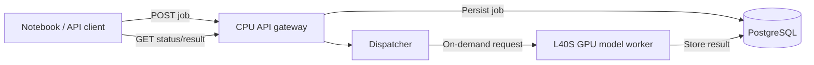

# Multilingual Translation AI Inference

> 🌐 Language / Ngôn ngữ: **English** | [Tiếng Việt](README.vi.md)

[](https://github.com/dangkhoa2016/Multilingual-Translation-AI-Inference/actions/workflows/python-validation.yml)
[](LICENSE)
[](MODEL_LICENSE.md)
[](https://www.python.org/)
[](CHANGELOG.md)

**An open-source toolkit for building your own multilingual translation API.**
Serve four model backends through one authenticated API, run them on
independent NVIDIA L40S workers, and store jobs and results in PostgreSQL.

Use it to integrate translation into an application, explore different model
outputs, or adapt the architecture for your own inference service. The MIT
source, API notebook and English/Vietnamese guides are available for anyone
to use, study and extend. [Community contributions are welcome](#contributing).

**Intended use — personal and trusted single-tenant deployments.**
This toolkit is designed for individuals, developers and teams operating their
own translation service with trusted clients, including internal business use.
The default gateway uses **one shared Bearer token and one shared job-owner
scope**. It does **not** provide independent user accounts, per-tenant job
authorization or data isolation, per-customer quotas or customer billing.
A public multi-user/SaaS service requires additional identity, authorization,
tenant isolation, abuse prevention and operational safeguards.
See [access scope](docs/configuration.md)
and the [community roadmap](docs/roadmap.md).

**Start here — choose a path:**

| Goal | First step | What you need |
|---|---|---|
| **Try locally:** explore the API workflow | [Offline quick start](#quick-start--no-gpu-required) | Python; no account, token or GPU |
| **Use your gateway:** send translations from a notebook | [API notebook](#api-notebook) | Your deployed HTTPS gateway and credentials |
| **Deploy yourself:** run the complete service | [Self-hosting guide](docs/deployment.md) | Your own Modal account and PostgreSQL database |

**On this page:** [Quick start](#quick-start--no-gpu-required) ·
[Features](#what-the-project-provides) · [Models](#supported-model-backends) ·
[API example](#api-example) · [Comparison](#compare-translation-model-outputs) ·
[Documentation](#documentation) · [Contributing](#contributing).

## Quick start — no GPU required

Install **Python 3.12 or newer**, then clone the repository:

```bash
git clone https://github.com/dangkhoa2016/Multilingual-Translation-AI-Inference.git
cd Multilingual-Translation-AI-Inference
git checkout v1.0.0

python -m venv .venv
source .venv/bin/activate
python -m pip install -e '.[demo]'
python scripts/examples/local_demo.py
```

**Windows PowerShell** (after cloning and entering the repository):

```powershell
py -3 --version  # Verify Python 3.12 or newer
py -3 -m venv .venv
.\.venv\Scripts\python.exe -m pip install -e ".[demo]"
.\.venv\Scripts\python.exe scripts/examples/local_demo.py
```

The demo submits and retrieves a job using temporary SQLite and a demo token.
Expect `POST 202`, `GET 200`, `status: completed` and `is_mock_result: true`.
Its output starts with `[MOCK ONLY — NOT A TRANSLATION; ...]`: it demonstrates
the API workflow with mock text, without network calls, `.env` or GPU use.

Next, explore the [API notebook](notebooks/translation_api_demo.ipynb) or
[deploy your own gateway](docs/deployment.md) for real translation.
After deployment, the root URL (`/`) serves a static English welcome page;
`/?lang=vi` switches to Vietnamese. Job requests under `/v1/` still require a Bearer token; the `GET /v1/models` catalog is public and rate-limited. No public translation
form or automatic Swagger/OpenAPI documentation is exposed.

## What the project provides

- **One API for four models:** choose a single backend or submit the same
  text to several models through an asynchronous job.
- **Persistent results:** PostgreSQL stores jobs, model attempts and
  translations for authenticated retrieval.
- **Per-run performance metrics:** authenticated GET returns optional token counts,
  queue/inference timings and best-effort CPU/GPU samples without raw logs.
- **On-demand GPU workers:** each model has its own L40S worker, pinned
  GGUF artifact, Modal Volume and decoding settings.
- **Request controls:** Bearer authentication, request/poll limits, idempotency,
  PostgreSQL-backed limits on unfinished jobs/runs, optional estimated GPU
  budgets and explicit recovery for uncertain jobs. See [configuration](docs/configuration.md).
- **Reusable examples and guides:** an offline demo, a Jupyter/Colab/Kaggle
  notebook, CPU tests and bilingual deployment documentation.

## How a translation job flows

Submit a job, let the selected worker process it, then retrieve its status
and translation. The gateway runs on CPU; GPU workers start on demand.



See [architecture](docs/architecture.md) for the full system and
[design decisions](docs/design-decisions.md) for the trade-offs.

## Supported model backends

| API model key | Upstream model | GPU | Quantization |
|---|---|---|---|
| `hy_mt2_30b` | Tencent Hy-MT2-30B-A3B | L40S 48 GB | GGUF Q8_0 |
| `index_35b` | IndexTeam Index-Translate-35B-A3B-preview | L40S 48 GB | GGUF Q8_0 |
| `gemma4_31b_it` | Google Gemma 4 31B IT | L40S 48 GB | GGUF Q8_0 |
| `qwen35_35b` | Qwen3.5-35B-A3B | L40S 48 GB | GGUF Q8_0 |

Use a language code or name such as `fr`, `zh-Hant` or `Vietnamese`.
Requests accept up to **1,000 Unicode code points**; model support and
translation quality vary by language pair. Text must be valid UTF-8 and contain
no NUL characters. See the [model catalog](docs/models.md)
for input rules, pinned revisions, checksums and observed GPU measurements.

### Self-hosting

Real translations run on **your own infrastructure**. Follow
[deployment](docs/deployment.md) to provision Modal, PostgreSQL, Secrets
and the four model Volumes. The [pinned GGUF files](models/four_l40s_workers_q8_0_manifest.json)
total **139.33 GB (129.76 GiB)** and are downloaded separately from the source.
For new deployments, use a private `.env` and the opt-in
`scripts/deployment/create_modal_secrets.py` helper to provision both Secrets.
The deployment guide also retains manual JSON provisioning.

GPU work is billable and requires explicit opt-in. GPU scale-to-zero does not eliminate
Volume or PostgreSQL storage/service costs. The **CPU operations monitor is
unscheduled by default**; an optional hourly schedule is enabled at deployment
and may incur CPU/PostgreSQL costs even without translation requests.
The default API is **single-tenant**
with a shared Bearer token; review [access configuration](docs/configuration.md),
[gateway security](docs/security.md), and [operations](docs/operations.md) before sharing your deployment. For changes to the shared API credential, follow [safe token rotation](docs/token-rotation.md).

## API example

After deploying and enabling the `modal-gpu` dispatcher, set your gateway
URL and load `TRANSLATION_API_BEARER_TOKEN` from your private credential store:

```bash
export TRANSLATION_GATEWAY_BASE_URL="https://YOUR_DEPLOYED_GATEWAY.modal.run"

curl -fsS -X POST "$TRANSLATION_GATEWAY_BASE_URL/v1/jobs/translations" \
  -H "Authorization: Bearer $TRANSLATION_API_BEARER_TOKEN" \
  -H "Idempotency-Key: example-translation-001" \
  -H "Content-Type: application/json" \
  -d '{
    "model": "hy_mt2_30b",
    "source_language": "en",
    "target_language": "vi",
    "text": "The little fox crossed the bridge at sunrise.",
    "options": {"preserve_formatting": true}
  }'
```

HTTP 202 returns a `job_id` and `status_url`. Copy the returned UUID into
`JOB_ID` and retrieve the job with GET using the same Bearer token:

```bash
JOB_ID="YOUR_RETURNED_JOB_UUID"
curl -fsS "$TRANSLATION_GATEWAY_BASE_URL/v1/jobs/$JOB_ID" \
  -H "Authorization: Bearer $TRANSLATION_API_BEARER_TOKEN"
```

Inspect the latest attempt of each model in `runs[]`; keep polling while
any is `queued`, `dispatching` or `running`. Use a new `Idempotency-Key`
for each new logical request. Reusing a retained key with different input
returns **HTTP 409**. If a POST has an uncertain outcome, keep its original
key/payload and reconcile with the operator before resubmitting.

The [API reference](docs/development.md#jobsubmitted-and-jobview--response-and-polling-rules)
covers response examples, job states and multi-model requests.
[Operations](docs/operations.md#job-retention-and-idempotency-lifetime)
explains retention and how long idempotency protection lasts.

## Compare translation model outputs

To compare the same text across multiple backends, use the benchmark endpoint with a
**different idempotency key** from the single-model example. This first paid comparison selects **two models**
to limit the number of inference runs. Choose any 1–4 distinct supported model keys; each selected
backend may incur GPU inference charges.

```bash
curl -fsS -X POST "$TRANSLATION_GATEWAY_BASE_URL/v1/jobs/benchmarks" \
  -H "Authorization: Bearer $TRANSLATION_API_BEARER_TOKEN" \
  -H "Idempotency-Key: example-benchmark-001" \
  -H "Content-Type: application/json" \
  -d '{
    "models": ["hy_mt2_30b", "index_35b"],
    "source_language": "en",
    "target_language": "vi",
    "text": "The little fox crossed the bridge at sunrise.",
    "options": {"preserve_formatting": true}
  }'
```

The benchmark returns HTTP 202 with a `job_id` and `status_url`. Use the same authenticated GET
above to inspect each selected model's latest attempt in `runs[]`. **No model is automatically ranked for translation quality.**

**Hand-written synthetic examples — not model output, GPU results or quality scores:**

| Field | Hy-MT2 (illustrative) | Index (illustrative) |
|---|---|---|
| Latest status | `completed` | `completed` |
| Vietnamese translation example | Chú cáo nhỏ băng qua cầu lúc bình minh. | Khi mặt trời mọc, chú cáo bé đi qua cây cầu. |

The example request selects two model keys, so its GET response will contain their runs. For all
four, add `gemma4_31b_it` and `qwen35_35b` to `models`; each extra model increases the possible GPU
work. The two sentences above were written only to illustrate the comparison layout.

The [notebook](notebooks/translation_api_demo.ipynb) displays job status, errors and
**the complete translation text** in both plain output and comparison tables.
It has no switch to hide translations. Use public, non-sensitive samples only;
do not publish notebook output containing private input or translations.


Per-model decoding is configurable on either endpoint through the optional
`model_configs` object (for example,
`{"hy_mt2_30b": {"temperature": 0.2}, "index_35b": {"max_tokens": 1024}}`).
Unspecified fields use per-model defaults. Details, limits and a runnable
benchmark payload are in the [per-model options guide](docs/models.md#per-model-inference-options).
Choose a new idempotency key when changing these settings; custom GPU output
has not been quality-benchmarked.

## API notebook

The [bilingual API notebook](notebooks/translation_api_demo.ipynb) runs on Colab, Kaggle and local Jupyter. It defaults to English (`DISPLAY_LANGUAGE="en"`; choose `"vi"` for Vietnamese) and safe CPU-only simulation (`DEMO_MODE="offline"`). Explicitly choose `DEMO_MODE="gpu"` to submit paid inference to your own authenticated GPU gateway.

**Default low-idle comparison — `BENCHMARK_SEQUENCE="per_model"`:** For each model, Run All submits one warm-up translation and *immediately* sends three distinct measured texts using one-model benchmark jobs, before moving to the next model. For four models this means **16 API jobs and 16 model runs** (four warm-ups + twelve measured). This reduces early-model cold restarts while other workers wait for GPU capacity. It still exercises both `POST /v1/jobs/translations` and `POST /v1/jobs/benchmarks`.

**Optional parallel comparison — `BENCHMARK_SEQUENCE="parallel"`:** The original five-job flow (single-model warm-up, remaining-model warm-up benchmark, three four-model benchmarks) is retained to demonstrate a concurrent benchmark endpoint. Both strategies submit 16 model runs. Neither strategy guarantees reuse when Modal replaces or evicts containers.

**Reports:** `warmup_jobs` and `measured_api_jobs` contain **real persisted HTTP jobs** in per-model mode. The three `benchmark_results` are explicitly marked presentation-only views assembled from independent real jobs, *without invented job UUIDs*. `comparison_summary` presents measured inference latency, queue/dispatch latency, end-to-end latency, tokens/s, VRAM and per-text comparison tables. The modern backend reports `worker_reuse_confirmed` (1=prior completed inference in the **same worker container**, 0=no prior success) and `engine_ready_ms` (llama.cpp launch to readiness) where available. Missing evidence is `N/A` and is **not inferred** from low queue times. Three texts of different lengths are descriptive samples, not a controlled same-length throughput or translation-quality ranking.

**Observed GPU validation:** In a documented opt-in GPU run, **16/16 real model runs** completed and **12/12 measured runs** confirmed same-container worker reuse. Median warm request latency and an unresolved Hy-MT2 cold-start outlier are documented in the [GPU validation results](docs/independent-validation.md#verified-per-model-gpu-inference) and [sanitized per-run numeric evidence](docs/gpu-per-model-evidence.json); these observations are not SLAs or translation-quality rankings.

**Cost and safe recovery:** Per-model sequencing reduces unnecessary idle waiting, while the default `scaledown_window=60` seconds and `min_containers=0` reduce cold starts across notebook polling and quota pacing. Idle GPU containers may incur charges. During longer experiments, operators may temporarily use a 120-second scaledown window and should restore 60 seconds afterward; see [validation and the forensic analysis](docs/independent-validation.md#observed-gpu-queue-delays). Run All reads private `TRANSLATION_GATEWAY_BASE_URL` and `TRANSLATION_API_BEARER_TOKEN` via environment/Colab/Kaggle Secrets or hidden prompts. Each stage has a distinct deterministic idempotency key based on `DEMO_RUN_ID`. Failures stop future GPU submissions, paid POSTs are never automatically retried, and `RECOVERY_JOB_ID="prompt"` performs GET-only recovery of a real accepted UUID. By default, `DEMO_RUN_ID="auto"` generates an ID once per Python kernel; restarting generates a new ID and may create new billable GPU jobs. The notebook displays source input before each request and alongside comparison results. Keep tokens, UUIDs and private translation text out of public outputs.

**Version `1.0.0`:** Both the [main branch](https://github.com/dangkhoa2016/Multilingual-Translation-AI-Inference/tree/main) and the [`v1.0.0` tag](https://github.com/dangkhoa2016/Multilingual-Translation-AI-Inference/tree/v1.0.0) identify the published source snapshot. Prefer the release tag when reproducing this notebook.

[](https://colab.research.google.com/github/dangkhoa2016/Multilingual-Translation-AI-Inference/blob/v1.0.0/notebooks/translation_api_demo.ipynb)
[](https://www.kaggle.com/notebooks/welcome?src=https://github.com/dangkhoa2016/Multilingual-Translation-AI-Inference/blob/v1.0.0/notebooks/translation_api_demo.ipynb)

Local Jupyter (optional):

```bash
python -m pip install jupyterlab
python -m jupyter lab notebooks/translation_api_demo.ipynb
```

A private local launcher is also available at [launch_jupyter_private.py](scripts/examples/launch_jupyter_private.py). See [independent validation](docs/independent-validation.md) and [deployment](docs/deployment.md) for live gateway setup and job recovery.

## Documentation

| I want to… | English | Tiếng Việt |
|---|---|---|
| Understand the architecture | [Architecture](docs/architecture.md) | [Kiến trúc](docs/architecture.vi.md) |
| Deploy my own service | [Deployment](docs/deployment.md) | [Triển khai](docs/deployment.vi.md) |
| Configure access and secrets | [Configuration](docs/configuration.md) | [Cấu hình](docs/configuration.vi.md) |
| Secure the API gateway | [Security](docs/security.md) | [Bảo mật](docs/security.vi.md) |
| Choose a model | [Models](docs/models.md) | [Model](docs/models.vi.md) |
| Integrate the API or develop locally | [API and development](docs/development.md) | [API và phát triển](docs/development.vi.md) |
| Monitor jobs and manage costs | [Operations](docs/operations.md) | [Vận hành](docs/operations.vi.md) |
| Check behavior and recorded results | [Reliability](docs/reliability.md) | [Độ tin cậy](docs/reliability.vi.md) |
| Test my installation | [Validation guide](docs/independent-validation.md) | [Kiểm tra cài đặt](docs/independent-validation.vi.md) |
| Understand design trade-offs | [Decisions](docs/design-decisions.md) | [Quyết định](docs/design-decisions.vi.md) |
| Explore future contributions | [Roadmap](docs/roadmap.md) | [Lộ trình](docs/roadmap.vi.md) |

The [reliability guide](docs/reliability.md#evidence-provenance-and-limitations)
describes the historical integration summaries in [`reports/`](reports),
their scope and how to reproduce the checks. They record infrastructure
behavior rather than translation-quality scores or live service availability.

## Contributing

Bug reports, examples, documentation improvements and translations are welcome.
You can contribute without a GPU or cloud account. Open a
[GitHub Issue](https://github.com/dangkhoa2016/Multilingual-Translation-AI-Inference/issues)
to report a problem or discuss an idea, then follow the
[contribution guide](.github/CONTRIBUTING.md) to submit a pull request.

### Optional contributor checks

```bash
python -m pip install -e '.[dev]'
python -m pytest -q
python -m ruff check .
```

These checks run on CPU. See [development](docs/development.md) for dependency
profiles and [support](.github/SUPPORT.md) for usage questions. Report
vulnerabilities through the [security policy](.github/SECURITY.md).
Source changes and release status are tracked in the [changelog](CHANGELOG.md).

## Licensing and attribution

Source code: **MIT © 2026 Đăng Khoa <i.am@dangkhoa.dev>** — see [LICENSE](LICENSE).
The pretrained models and GGUF derivatives retain their upstream
**Apache-2.0** licenses and attribution; model weights are distributed separately.
See [model licenses](MODEL_LICENSE.md) and [third-party notices](NOTICE.md).

This is an independent community project, unaffiliated with Tencent,
IndexTeam, Google, Unsloth, Qwen or Modal.
