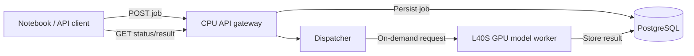

# Multilingual Translation AI Inference

> 🌐 Language / Ngôn ngữ: **English** | [Tiếng Việt](README.vi.md)

[](https://github.com/dangkhoa2016/Multilingual-Translation-AI-Inference/actions/workflows/python-validation.yml)
[](LICENSE)
[](MODEL_LICENSE.md)
[](https://www.python.org/)
[](CHANGELOG.md)

**An open-source toolkit for building your own multilingual translation API.**
Serve four model backends through one authenticated API, run them on
independent NVIDIA L40S workers, and store jobs and results in PostgreSQL.

Use it to integrate translation into an application, explore different model
outputs, or adapt the architecture for your own inference service. The MIT
source, API notebook and English/Vietnamese guides are available for anyone
to use, study and extend. [Community contributions are welcome](#contributing).

**Start here — choose a path:**

| Goal | First step | What you need |
|---|---|---|
| **Try locally:** explore the API workflow | [Offline quick start](#quick-start--no-gpu-required) | Python; no account, token or GPU |
| **Use your gateway:** send translations from a notebook | [API notebook](#api-notebook) | Your deployed HTTPS gateway and credentials |
| **Deploy yourself:** run the complete service | [Self-hosting guide](docs/deployment.md) | Your own Modal account and PostgreSQL database |

**On this page:** [Quick start](#quick-start--no-gpu-required) ·
[Features](#what-the-project-provides) · [Models](#supported-model-backends) ·
[API example](#api-example) · [Comparison](#compare-translation-model-outputs) ·
[Documentation](#documentation) · [Contributing](#contributing).

## Quick start — no GPU required

Install **Python 3.12 or newer**, then clone the repository:

```bash
git clone https://github.com/dangkhoa2016/Multilingual-Translation-AI-Inference.git
cd Multilingual-Translation-AI-Inference
git checkout v1.0.0

python -m venv .venv
source .venv/bin/activate
python -m pip install -e '.[demo]'
python scripts/examples/local_demo.py
```

**Windows PowerShell** (after cloning and entering the repository):

```powershell
py -3 --version  # Verify Python 3.12 or newer
py -3 -m venv .venv
.\.venv\Scripts\python.exe -m pip install -e ".[demo]"
.\.venv\Scripts\python.exe scripts/examples/local_demo.py
```

The demo submits and retrieves a job using temporary SQLite and a demo token.
Expect `POST 202`, `GET 200`, `status: completed` and `is_mock_result: true`.
Its output starts with `[MOCK ONLY — NOT A TRANSLATION; ...]`: it demonstrates
the API workflow with mock text, without network calls, `.env` or GPU use.

Next, explore the [API notebook](notebooks/translation_api_demo.ipynb) or
[deploy your own gateway](docs/deployment.md) for real translation.

## What the project provides

- **One API for four models:** choose a single backend or submit the same
  text to several models through an asynchronous job.
- **Persistent results:** PostgreSQL stores jobs, model attempts and
  translations for authenticated retrieval.
- **Per-run performance metrics:** authenticated GET returns optional token counts,
  queue/inference timings and best-effort CPU/GPU samples without raw logs.
- **On-demand GPU workers:** each model has its own L40S worker, pinned
  GGUF artifact, Modal Volume and decoding settings.
- **Request controls:** Bearer authentication, request/poll limits, idempotency,
  PostgreSQL-backed limits on unfinished jobs/runs, optional estimated GPU
  budgets and explicit recovery for uncertain jobs. See [configuration](docs/configuration.md).
- **Reusable examples and guides:** an offline demo, a Jupyter/Colab/Kaggle
  notebook, CPU tests and bilingual deployment documentation.

## How a translation job flows

Submit a job, let the selected worker process it, then retrieve its status
and translation. The gateway runs on CPU; GPU workers start on demand.



See [architecture](docs/architecture.md) for the full system and
[design decisions](docs/design-decisions.md) for the trade-offs.

## Supported model backends

| API model key | Upstream model | GPU | Quantization |
|---|---|---|---|
| `hy_mt2_30b` | Tencent Hy-MT2-30B-A3B | L40S 48 GB | GGUF Q8_0 |
| `index_35b` | IndexTeam Index-Translate-35B-A3B-preview | L40S 48 GB | GGUF Q8_0 |
| `gemma4_31b_it` | Google Gemma 4 31B IT | L40S 48 GB | GGUF Q8_0 |
| `qwen35_35b` | Qwen3.5-35B-A3B | L40S 48 GB | GGUF Q8_0 |

Use a language code or name such as `fr`, `zh-Hant` or `Vietnamese`.
Requests accept up to **1,000 Unicode code points**; model support and
translation quality vary by language pair. Text must be valid UTF-8 and contain
no NUL characters. See the [model catalog](docs/models.md)
for input rules, pinned revisions, checksums and observed GPU measurements.

### Self-hosting

Real translations run on **your own infrastructure**. Follow
[deployment](docs/deployment.md) to provision Modal, PostgreSQL, Secrets
and the four model Volumes. The [pinned GGUF files](models/four_l40s_workers_q8_0_manifest.json)
total **139.33 GB (129.76 GiB)** and are downloaded separately from the source.

GPU work is billable and requires explicit opt-in. GPU scale-to-zero does not eliminate
Volume or PostgreSQL storage/service costs. The **CPU operations monitor is
unscheduled by default**; an optional hourly schedule is enabled at deployment
and may incur CPU/PostgreSQL costs even without translation requests.
The default API is **single-tenant**
with a shared Bearer token; review [access configuration](docs/configuration.md),
[gateway security](docs/security.md), and [operations](docs/operations.md) before sharing your deployment.

## API example

After deploying and enabling the `modal-gpu` dispatcher, set your gateway
URL and load `TRANSLATION_API_BEARER_TOKEN` from your private credential store:

```bash
export TRANSLATION_GATEWAY_BASE_URL="https://YOUR_DEPLOYED_GATEWAY.modal.run"

curl -fsS -X POST "$TRANSLATION_GATEWAY_BASE_URL/v1/jobs/translations" \
  -H "Authorization: Bearer $TRANSLATION_API_BEARER_TOKEN" \
  -H "Idempotency-Key: example-translation-001" \
  -H "Content-Type: application/json" \
  -d '{
    "model": "hy_mt2_30b",
    "source_language": "en",
    "target_language": "vi",
    "text": "The little fox crossed the bridge at sunrise.",
    "options": {"preserve_formatting": true}
  }'
```

HTTP 202 returns a `job_id` and `status_url`. Copy the returned UUID into
`JOB_ID` and retrieve the job with GET using the same Bearer token:

```bash
JOB_ID="YOUR_RETURNED_JOB_UUID"
curl -fsS "$TRANSLATION_GATEWAY_BASE_URL/v1/jobs/$JOB_ID" \
  -H "Authorization: Bearer $TRANSLATION_API_BEARER_TOKEN"
```

Inspect the latest attempt of each model in `runs[]`; keep polling while
any is `queued`, `dispatching` or `running`. Use a new `Idempotency-Key`
for each new logical request. Reusing a retained key with different input
returns **HTTP 409**. If a POST has an uncertain outcome, keep its original
key/payload and reconcile with the operator before resubmitting.

The [API reference](docs/development.md#jobsubmitted-and-jobview--response-and-polling-rules)
covers response examples, job states and multi-model requests.
[Operations](docs/operations.md#job-retention-and-idempotency-lifetime)
explains retention and how long idempotency protection lasts.

## Compare translation model outputs

To compare the same text across multiple backends, use the benchmark endpoint with a
**different idempotency key** from the single-model example. This first paid comparison selects **two models**
to limit the number of inference runs. Choose any 1–4 distinct supported model keys; each selected
backend may incur GPU inference charges.

```bash
curl -fsS -X POST "$TRANSLATION_GATEWAY_BASE_URL/v1/jobs/benchmarks" \
  -H "Authorization: Bearer $TRANSLATION_API_BEARER_TOKEN" \
  -H "Idempotency-Key: example-benchmark-001" \
  -H "Content-Type: application/json" \
  -d '{
    "models": ["hy_mt2_30b", "index_35b"],
    "source_language": "en",
    "target_language": "vi",
    "text": "The little fox crossed the bridge at sunrise.",
    "options": {"preserve_formatting": true}
  }'
```

The benchmark returns HTTP 202 with a `job_id` and `status_url`. Use the same authenticated GET
above to inspect each selected model's latest attempt in `runs[]`. **No model is automatically ranked for translation quality.**

**Hand-written synthetic examples — not model output, GPU results or quality scores:**

| Field | Hy-MT2 (illustrative) | Index (illustrative) |
|---|---|---|
| Latest status | `completed` | `completed` |
| Vietnamese translation example | Chú cáo nhỏ băng qua cầu lúc bình minh. | Khi mặt trời mọc, chú cáo bé đi qua cây cầu. |

The example request selects two model keys, so its GET response will contain their runs. For all
four, add `gemma4_31b_it` and `qwen35_35b` to `models`; each extra model increases the possible GPU
work. The two sentences above were written only to illustrate the comparison layout.

The [notebook](notebooks/translation_api_demo.ipynb) displays actual job status, errors and optional
translation text per model. Keep `SHOW_TRANSLATIONS=False` for sensitive or publicly shared notebook
inputs.


## API notebook

**Execution safety:** `Run All` is fully offline only when **all live HTTP flags**
remain `False`, including optional GET flags and both paid POST switches.
GET flags may contact your gateway without submitting a new translation job;
either paid POST switch may submit billable GPU work. For live inference,
run only the selected cells in the documented order; do not use `Run All`
with paid POST switches enabled.
Keep the original idempotency key and job UUID if a POST result is uncertain.

**Source release `1.0.0`:** The reviewed [`main` source](https://github.com/dangkhoa2016/Multilingual-Translation-AI-Inference/tree/main)
and the [`v1.0.0` tag](https://github.com/dangkhoa2016/Multilingual-Translation-AI-Inference/tree/v1.0.0)
identify the same finalized source snapshot at publication. The
[GitHub Release](https://github.com/dangkhoa2016/Multilingual-Translation-AI-Inference/releases/tag/v1.0.0)
provides the corresponding tagged archive. For reproducible installations,
prefer the tag; `main` can evolve after publication.

[](https://colab.research.google.com/github/dangkhoa2016/Multilingual-Translation-AI-Inference/blob/v1.0.0/notebooks/translation_api_demo.ipynb)
[](https://www.kaggle.com/notebooks/welcome?src=https://github.com/dangkhoa2016/Multilingual-Translation-AI-Inference/blob/v1.0.0/notebooks/translation_api_demo.ipynb)

Use [translation_api_demo.ipynb](notebooks/translation_api_demo.ipynb) in
Jupyter, Google Colab or Kaggle Notebooks to select a model, submit text
and retrieve translations. In **Basic settings**, choose `DISPLAY_LANGUAGE="en"`
or `"vi"` for notebook messages; this is separate from translation languages.
For local Jupyter:

```bash
python -m pip install jupyterlab
python -m jupyter lab notebooks/translation_api_demo.ipynb
```

1. Leave all live flags `False` and **Run All** once for the synthetic four-model preview (the paid comparison defaults to two models).
2. In **Basic Settings**, choose a model, languages and sample text. Load your
   gateway and Bearer token through private Secrets.
3. Enable `ACKNOWLEDGE_PAID_GPU` and `RUN_SUBMITTED_JOB_POLL` for paid inference.
   For one model, enable `RUN_SINGLE_MODEL_POST` and select `"single"` for
   `SUBMITTED_JOB_TO_POLL`. For comparison, enable `RUN_MULTI_MODEL_POST`, select
   `"multi"` and choose `MULTI_MODEL_KEYS` (two by default; explicitly select up to four). Keep the other POST flag off.
4. Run **Basic Settings → Load private Secrets → POST translation → GET job** for
   one model, or replace **POST translation** with **POST benchmark** for comparison.
   Both modes are configured in Basic Settings; Advanced Settings is optional.
   **Do not Run All while paid POST flags are enabled.**
5. To view non-sensitive translations, turn both POST flags off, set `SHOW_TRANSLATIONS=True`
   and run **Basic Settings → GET job**. The table places each model's latest result
   in its own column, including status, errors and optional performance metrics
   (set `SHOW_METRICS=False` to hide). Missing metrics appear as `N/A`; the GPU
   sample is not a peak or average. Translation text and UUIDs stay hidden by default;
   `SHOW_JOB_IDS=True` reveals UUIDs in a private session.

For local live use, the [private launcher](scripts/examples/launch_jupyter_private.py)
prompts for your gateway and hides token input:

```bash
python scripts/examples/launch_jupyter_private.py
```

Support-code cells are collapsed by default for a clearer first run; expand them
if you want to audit the client implementation.

Use the notebook's **Advanced usage and recovery** section for kernel restarts,
saved jobs or uncertain requests. Initialize offline again after each restart.
On Windows, use `.\.venv\Scripts\python.exe` in place of `python`.

## Documentation

| I want to… | English | Tiếng Việt |
|---|---|---|
| Understand the architecture | [Architecture](docs/architecture.md) | [Kiến trúc](docs/architecture.vi.md) |
| Deploy my own service | [Deployment](docs/deployment.md) | [Triển khai](docs/deployment.vi.md) |
| Configure access and secrets | [Configuration](docs/configuration.md) | [Cấu hình](docs/configuration.vi.md) |
| Secure the API gateway | [Security](docs/security.md) | [Bảo mật](docs/security.vi.md) |
| Choose a model | [Models](docs/models.md) | [Model](docs/models.vi.md) |
| Integrate the API or develop locally | [API and development](docs/development.md) | [API và phát triển](docs/development.vi.md) |
| Monitor jobs and manage costs | [Operations](docs/operations.md) | [Vận hành](docs/operations.vi.md) |
| Check behavior and recorded results | [Reliability](docs/reliability.md) | [Độ tin cậy](docs/reliability.vi.md) |
| Test my installation | [Validation guide](docs/independent-validation.md) | [Kiểm tra cài đặt](docs/independent-validation.vi.md) |
| Understand design trade-offs | [Decisions](docs/design-decisions.md) | [Quyết định](docs/design-decisions.vi.md) |
| Explore future contributions | [Roadmap](docs/roadmap.md) | [Lộ trình](docs/roadmap.vi.md) |

The [reliability guide](docs/reliability.md#evidence-provenance-and-limitations)
describes the historical integration summaries in [`reports/`](reports),
their scope and how to reproduce the checks. They record infrastructure
behavior rather than translation-quality scores or live service availability.

## Contributing

Bug reports, examples, documentation improvements and translations are welcome.
You can contribute without a GPU or cloud account. Open a
[GitHub Issue](https://github.com/dangkhoa2016/Multilingual-Translation-AI-Inference/issues)
to report a problem or discuss an idea, then follow the
[contribution guide](.github/CONTRIBUTING.md) to submit a pull request.

### Optional contributor checks

```bash
python -m pip install -e '.[dev]'
python -m pytest -q
python -m ruff check .
```

These checks run on CPU. See [development](docs/development.md) for dependency
profiles and [support](.github/SUPPORT.md) for usage questions. Report
vulnerabilities through the [security policy](.github/SECURITY.md).
Source changes and release status are tracked in the [changelog](CHANGELOG.md).

## Licensing and attribution

Source code: **MIT © 2026 Đăng Khoa <i.am@dangkhoa.dev>** — see [LICENSE](LICENSE).
The pretrained models and GGUF derivatives retain their upstream
**Apache-2.0** licenses and attribution; model weights are distributed separately.
See [model licenses](MODEL_LICENSE.md) and [third-party notices](NOTICE.md).

This is an independent community project, unaffiliated with Tencent,
IndexTeam, Google, Unsloth, Qwen or Modal.
