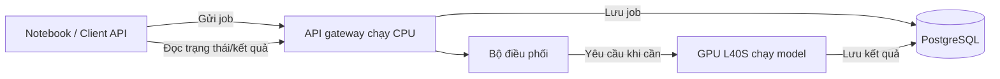

# Multilingual Translation AI Inference

> 🌐 Language / Ngôn ngữ: [English](README.md) | **Tiếng Việt**

[](https://github.com/dangkhoa2016/Multilingual-Translation-AI-Inference/actions/workflows/python-validation.yml)
[](LICENSE)
[](MODEL_LICENSE.vi.md)
[](https://www.python.org/)
[](CHANGELOG.vi.md)

**Bộ công cụ mã nguồn mở để xây dựng API dịch thuật đa ngôn ngữ của bạn.**
Sử dụng bốn model qua cùng một API có xác thực, chạy trên các worker
NVIDIA L40S độc lập và lưu job cùng kết quả trong PostgreSQL.

Bạn có thể tích hợp dịch thuật vào ứng dụng, tìm hiểu đầu ra của từng model
hoặc điều chỉnh kiến trúc cho dịch vụ inference riêng. Mã nguồn MIT,
notebook API và hướng dẫn tiếng Anh/tiếng Việt được chia sẻ để mọi người
sử dụng, học hỏi và phát triển tiếp. [Mời bạn cùng đóng góp](#đóng-góp).

**Phạm vi sử dụng — cá nhân và triển khai single-tenant trong môi trường tin cậy.**
Bộ công cụ dành cho cá nhân, developer và nhóm tự vận hành dịch vụ dịch thuật
cho các client đáng tin cậy, bao gồm cả nhu cầu nội bộ doanh nghiệp.
Gateway mặc định sử dụng **một Bearer token và một phạm vi sở hữu job dùng
chung**. Dự án **chưa cung cấp** tài khoản độc lập theo người dùng, phân quyền
hoặc cách ly dữ liệu theo tenant, quota riêng theo khách hàng hay tính phí
theo khách hàng. Để cung cấp dịch vụ SaaS/nhiều người dùng công khai, cần
thiết kế thêm định danh, phân quyền, cách ly tenant, chống lạm dụng và các
biện pháp vận hành phù hợp.
Xem [phạm vi quyền truy cập](docs/configuration.vi.md)
và [lộ trình cộng đồng](docs/roadmap.vi.md).

**Bắt đầu — chọn một cách sử dụng:**

| Mục tiêu | Bắt đầu tại | Bạn cần |
|---|---|---|
| **Chạy thử local:** tìm hiểu luồng API | [Chạy thử offline](#bắt-đầu--không-cần-gpu) | Python; không cần tài khoản, token hay GPU |
| **Đã có gateway riêng:** gửi yêu cầu từ notebook | [Notebook API](#notebook-api) | HTTPS gateway đã triển khai và thông tin xác thực của bạn |
| **Tự triển khai:** chạy toàn bộ hệ thống | [Hướng dẫn triển khai](docs/deployment.vi.md) | Tài khoản Modal và PostgreSQL riêng |

**Trong trang này:** [Bắt đầu](#bắt-đầu--không-cần-gpu) · [Tính năng](#dự-án-cung-cấp-những-gì) ·
[Model](#bốn-model-được-hỗ-trợ) · [Ví dụ API](#ví-dụ-gọi-api) ·
[So sánh model](#so-sánh-kết-quả-dịch-giữa-các-model) · [Tài liệu](#tài-liệu) · [Đóng góp](#đóng-góp).

## Bắt đầu — không cần GPU

Cài **Python 3.12 trở lên**, sau đó clone repository:

```bash
git clone https://github.com/dangkhoa2016/Multilingual-Translation-AI-Inference.git
cd Multilingual-Translation-AI-Inference
git checkout v1.0.0

python -m venv .venv
source .venv/bin/activate
python -m pip install -e '.[demo]'
python scripts/examples/local_demo.py
```

**Windows PowerShell** (sau khi clone và vào thư mục repository):

```powershell
py -3 --version  # Xác nhận Python 3.12 trở lên
py -3 -m venv .venv
.\.venv\Scripts\python.exe -m pip install -e ".[demo]"
.\.venv\Scripts\python.exe scripts/examples/local_demo.py
```

Demo gửi và đọc job bằng SQLite tạm thời cùng token mẫu. Kết quả mong đợi:
`POST 202`, `GET 200`, `status: completed` và `is_mock_result: true`.
Đầu ra bắt đầu bằng `[MOCK ONLY — NOT A TRANSLATION; ...]`: đây là luồng API
với văn bản mock, không gọi mạng, đọc `.env` hay sử dụng GPU.

Tiếp theo, thử [notebook API](notebooks/translation_api_demo.ipynb) hoặc
[triển khai gateway riêng](docs/deployment.vi.md) để dịch bằng model thật.
Sau khi triển khai, URL gốc (`/`) hiển thị trang giới thiệu tiếng Anh;
`/?lang=vi` chuyển sang tiếng Việt. Các request gửi/đọc job dưới `/v1/` vẫn cần Bearer token; catalog `GET /v1/models` công khai và có rate limit. Dự án không mở form dịch
công khai hoặc Swagger/OpenAPI tự động.

## Dự án cung cấp những gì?

- **Một API cho bốn model:** chọn một backend hoặc gửi cùng văn bản
  đến nhiều model qua job bất đồng bộ.
- **Kết quả được lưu bền vững:** PostgreSQL giữ job, từng lần chạy model
  và bản dịch để truy xuất có xác thực.
- **Thông số theo từng lần chạy:** GET trả số token, thời gian chờ/inference
  và mẫu CPU/GPU tùy chọn; không công khai raw log hay bí mật.
- **GPU worker chạy theo nhu cầu:** mỗi model có L40S worker, tệp GGUF
  được khóa revision, Modal Volume và cấu hình sinh văn bản riêng.
- **Kiểm soát yêu cầu:** xác thực Bearer, giới hạn request/poll, idempotency,
  trần job/run chưa hoàn tất dùng chung PostgreSQL, ngân sách GPU ước tính
  tùy chọn và đối soát job uncertain. Xem [cấu hình](docs/configuration.vi.md).
- **Ví dụ và hướng dẫn có thể tái sử dụng:** demo offline, notebook
  Jupyter/Colab/Kaggle, test CPU và tài liệu triển khai song ngữ.

## Vòng đời một job dịch thuật

Gửi job, để worker tương ứng xử lý, rồi truy xuất trạng thái và bản dịch.
Gateway chạy trên CPU; GPU worker khởi động theo nhu cầu.



Xem [kiến trúc](docs/architecture.vi.md) để tìm hiểu toàn bộ hệ thống và
[quyết định kỹ thuật](docs/design-decisions.vi.md) để hiểu các đánh đổi.

## Bốn model được hỗ trợ

| API model key | Tên model gốc | GPU | Quantization |
|---|---|---|---|
| `hy_mt2_30b` | Tencent Hy-MT2-30B-A3B | L40S 48 GB | GGUF Q8_0 |
| `index_35b` | IndexTeam Index-Translate-35B-A3B-preview | L40S 48 GB | GGUF Q8_0 |
| `gemma4_31b_it` | Google Gemma 4 31B IT | L40S 48 GB | GGUF Q8_0 |
| `qwen35_35b` | Qwen3.5-35B-A3B | L40S 48 GB | GGUF Q8_0 |

Nhập mã hoặc tên ngôn ngữ như `fr`, `zh-Hant` hay `Vietnamese`.
Mỗi yêu cầu nhận tối đa **1.000 Unicode code points**; khả năng hỗ trợ
và chất lượng dịch tùy cặp ngôn ngữ. Văn bản phải mã hóa được thành UTF-8
và không chứa ký tự NUL. Xem [danh mục model](docs/models.vi.md)
để biết quy tắc đầu vào, revision, checksum và số liệu GPU đã ghi nhận.

### Tự triển khai

Bản dịch thật chạy trên **hạ tầng do bạn quản lý**. Làm theo
[hướng dẫn triển khai](docs/deployment.vi.md) để chuẩn bị Modal, PostgreSQL,
Secrets và bốn Volume model. Các [tệp GGUF đã khóa revision](models/four_l40s_workers_q8_0_manifest.json)
có tổng dung lượng **139,33 GB (129,76 GiB)**, được tải riêng với mã nguồn.
Khi triển khai mới, dùng `.env` riêng tư và script
`scripts/deployment/create_modal_secrets.py` để chủ động tạo hai Secrets.
Tài liệu triển khai vẫn hướng dẫn cách tạo file JSON thủ công.

Tác vụ GPU có tính phí và cần chủ động bật. GPU scale-to-zero không loại bỏ
chi phí lưu trữ/dịch vụ của Volume hoặc PostgreSQL. **CPU monitor mặc định
không có lịch tự động**; có thể chủ động bật kiểm tra mỗi giờ khi deploy.
Lịch CPU và truy vấn PostgreSQL vẫn có thể tính phí khi không có yêu cầu dịch.
API mặc định là **single-tenant**,
dùng chung Bearer token; xem [cấu hình quyền truy cập](docs/configuration.vi.md),
[bảo mật gateway](docs/security.vi.md) và [vận hành](docs/operations.vi.md)
trước khi chia sẻ deployment. Khi cần đổi API token đang dùng chung, xem [hướng dẫn thay Bearer token an toàn](docs/token-rotation.vi.md).

## Ví dụ gọi API

Sau khi triển khai và bật dispatcher `modal-gpu`, đặt URL gateway và nạp
`TRANSLATION_API_BEARER_TOKEN` từ nơi lưu thông tin xác thực riêng của bạn:

```bash
export TRANSLATION_GATEWAY_BASE_URL="https://YOUR_DEPLOYED_GATEWAY.modal.run"

curl -fsS -X POST "$TRANSLATION_GATEWAY_BASE_URL/v1/jobs/translations" \
  -H "Authorization: Bearer $TRANSLATION_API_BEARER_TOKEN" \
  -H "Idempotency-Key: example-translation-001" \
  -H "Content-Type: application/json" \
  -d '{
    "model": "hy_mt2_30b",
    "source_language": "en",
    "target_language": "vi",
    "text": "The little fox crossed the bridge at sunrise.",
    "options": {"preserve_formatting": true}
  }'
```

HTTP 202 trả về `job_id` và `status_url`. Điền UUID được trả về vào
`JOB_ID`, rồi gọi GET để đọc job bằng cùng Bearer token:

```bash
JOB_ID="YOUR_RETURNED_JOB_UUID"
curl -fsS "$TRANSLATION_GATEWAY_BASE_URL/v1/jobs/$JOB_ID" \
  -H "Authorization: Bearer $TRANSLATION_API_BEARER_TOKEN"
```

Xem attempt mới nhất của từng model trong `runs[]`; tiếp tục polling khi
còn attempt `queued`, `dispatching` hoặc `running`. Mỗi yêu cầu mới dùng
một `Idempotency-Key` mới. Dùng lại key còn lưu với đầu vào khác sẽ trả
**HTTP 409**. Nếu POST có kết quả chưa rõ (uncertain), giữ key/payload gốc
và đối soát với người vận hành trước khi gửi lại.

[Tài liệu API](docs/development.vi.md#jobsubmitted-và-jobview--response-và-quy-tắc-polling)
giải thích ví dụ response, trạng thái job và yêu cầu nhiều model.
[Hướng dẫn vận hành](docs/operations.vi.md#lưu-giữ-job-và-thời-hạn-bảo-vệ-idempotency)
trình bày cách lưu giữ job và thời hạn bảo vệ idempotency.

## So sánh kết quả dịch giữa các model

Để so sánh cùng một văn bản qua nhiều backend, dùng endpoint benchmark với
**idempotency key riêng**, khác với ví dụ dịch một model. Ví dụ chạy thật đầu tiên chọn **hai model** để giảm số lượt
inference cần thực hiện. Bạn có thể chọn 1–4 model key hợp lệ, không trùng nhau; mỗi backend được
chọn đều có thể phát sinh chi phí GPU.

```bash
curl -fsS -X POST "$TRANSLATION_GATEWAY_BASE_URL/v1/jobs/benchmarks" \
  -H "Authorization: Bearer $TRANSLATION_API_BEARER_TOKEN" \
  -H "Idempotency-Key: example-benchmark-001" \
  -H "Content-Type: application/json" \
  -d '{
    "models": ["hy_mt2_30b", "index_35b"],
    "source_language": "en",
    "target_language": "vi",
    "text": "The little fox crossed the bridge at sunrise.",
    "options": {"preserve_formatting": true}
  }'
```

Endpoint benchmark cũng trả HTTP 202 cùng `job_id` và `status_url`. Dùng GET có xác thực ở trên để
kiểm tra attempt mới nhất của từng model trong `runs[]`. **Hệ thống không tự xếp hạng chất lượng bản dịch.**

**Ví dụ synthetic do người viết tự tạo — không phải đầu ra model, kết quả GPU hay điểm chất lượng:**

| Trường | Hy-MT2 (minh họa) | Index (minh họa) |
|---|---|---|
| Trạng thái mới nhất | `completed` | `completed` |
| Ví dụ bản dịch tiếng Việt | Chú cáo nhỏ băng qua cầu lúc bình minh. | Khi mặt trời mọc, chú cáo bé đi qua cây cầu. |

Yêu cầu API minh họa chỉ chọn hai model, nên GET sẽ chứa các run tương ứng. Muốn so sánh cả bốn, bổ
sung `gemma4_31b_it` và `qwen35_35b` vào `models`; thêm model có thể làm tăng chi phí GPU. Hai câu
trên chỉ dùng để minh họa cách trình bày kết quả.

[Notebook](notebooks/translation_api_demo.ipynb) hiển thị trạng thái job, lỗi và
**toàn bộ nội dung bản dịch**, cả ở output văn bản và bảng so sánh.
Notebook không có tùy chọn ẩn bản dịch. Chỉ dùng văn bản mẫu công khai, không
nhạy cảm; không chia sẻ output chứa dữ liệu riêng tư.


Hai endpoint cho phép tùy chỉnh decoding theo từng model qua
`model_configs` (ví dụ,
`{"hy_mt2_30b": {"temperature": 0.2}, "index_35b": {"max_tokens": 1024}}`).
Các trường không truyền giữ mặc định của từng model. Xem giới hạn và payload
minh họa trong [tài liệu tùy chọn từng model](docs/models.vi.md#tùy-chỉnh-tham-số-riêng-cho-từng-model).
Khi thay đổi cấu hình cần dùng idempotency key mới; chưa có benchmark GPU
xác minh chất lượng đối với cấu hình tùy chỉnh.

## Notebook API

[Notebook API song ngữ](notebooks/translation_api_demo.ipynb) chạy trên Colab, Kaggle và Jupyter. Mặc định **tiếng Anh** (`DISPLAY_LANGUAGE="en"`, đổi `"vi"` để xem tiếng Việt), và mặc định giả lập CPU an toàn (`DEMO_MODE="offline"`). Chỉ chủ động đặt `DEMO_MODE="gpu"` để gửi inference có phí tới gateway GPU đã xác thực của bạn.

**Chế độ mới mặc định — `BENCHMARK_SEQUENCE="per_model"`:** Notebook warm-up từng model bằng một job dịch, rồi **ngay lập tức** dịch cùng ba văn bản trên chính model đó qua endpoint benchmark một model. Sau đó mới chuyển tới model tiếp theo. Với bốn model sẽ có **16 API jobs và 16 model runs** (bốn warm-up + mười hai lượt đo). Cách này giảm nguy cơ model chạy sớm bị tắt khi phải chờ model khác khởi động. Vẫn kiểm tra cả endpoint translation và benchmark.

**Chế độ tùy chọn — `BENCHMARK_SEQUENCE="parallel"`:** Giữ luồng cũ năm job (warm-up model đầu, warm-up benchmark ba model còn lại và ba benchmark bốn model). Cả hai chế độ đều có 16 model runs; không bảo đảm tuyệt đối container được tái sử dụng.

**Báo cáo:** `warmup_jobs` và `measured_api_jobs` chứa **API jobs thực tế** trong chế độ per-model. Ba `benchmark_results` là các **bảng so sánh được ghép tại notebook** từ các job thật, không tạo UUID giả. `comparison_summary` hiển thị inference, queue/dispatch, end-to-end, tokens/s, VRAM và bảng từng văn bản. Backend mới trả `worker_reuse_confirmed` (1=có inference hoàn tất trước đó trong cùng worker; 0=chưa có) cùng `engine_ready_ms` (llama.cpp khởi động đến lúc sẵn sàng). Nếu chưa có bằng chứng, hiện `N/A`, không tự suy luận warm từ queue ngắn. Ba văn bản khác độ dài nên không phải thử nghiệm lặp cùng độ dài hoặc xếp hạng chất lượng dịch.

**Kết quả GPU thực tế:** Trong một phiên kiểm thử GPU có chủ đích, **16/16 lượt model-run** hoàn thành và **12/12 lượt đo** xác nhận tái sử dụng worker cùng container. Trung vị độ trễ warm và trường hợp cold start Hy-MT2 chưa rõ nguyên nhân được nêu trong [báo cáo nghiệm thu GPU](docs/independent-validation.vi.md#nghiệm-thu-gpu-theo-từng-model) và [bằng chứng số đã làm sạch](docs/gpu-per-model-evidence.json); đây không phải SLA hay xếp hạng chất lượng dịch.

**Chi phí và khôi phục an toàn:** GPU worker mặc định dùng `scaledown_window=60` giây và `min_containers=0` để giảm cold start giữa các request notebook. GPU idle có thể phát sinh phí. Operator có thể tạm tăng cửa sổ lên 120 giây rồi khôi phục 60 giây. Xem [nghiệm thu và phân tích thực tế](docs/independent-validation.vi.md#quan-sát-độ-trễ-gpu). Notebook đọc URL/token riêng từ environment hoặc Secrets, thiếu thì hỏi qua prompt ẩn. Mỗi stage có idempotency key theo `DEMO_RUN_ID`, lỗi khiến notebook dừng các GPU POST còn lại và không tự lặp POST có phí. `RECOVERY_JOB_ID="prompt"` chỉ GET UUID job thật. Mặc định `DEMO_RUN_ID="auto"` tạo ID một lần trong mỗi Python kernel; restart sẽ tạo ID mới và có thể phát sinh GPU jobs tính phí. Notebook hiển thị văn bản nguồn trước từng request và cùng bảng kết quả. Không công khai token, UUID hay dữ liệu nhạy cảm.

**Phiên bản `1.0.0`:** [Nhánh main](https://github.com/dangkhoa2016/Multilingual-Translation-AI-Inference/tree/main) và [tag `v1.0.0`](https://github.com/dangkhoa2016/Multilingual-Translation-AI-Inference/tree/v1.0.0) cùng trỏ đến bản nguồn đã phát hành. Nên dùng tag để tái lập chính xác.

[](https://colab.research.google.com/github/dangkhoa2016/Multilingual-Translation-AI-Inference/blob/v1.0.0/notebooks/translation_api_demo.ipynb)
[](https://www.kaggle.com/notebooks/welcome?src=https://github.com/dangkhoa2016/Multilingual-Translation-AI-Inference/blob/v1.0.0/notebooks/translation_api_demo.ipynb)

Jupyter local (tùy chọn):

```bash
python -m pip install jupyterlab
python -m jupyter lab notebooks/translation_api_demo.ipynb
```

Xem thêm [launcher Jupyter riêng tư](scripts/examples/launch_jupyter_private.py), [hướng dẫn nghiệm thu độc lập](docs/independent-validation.vi.md) và [triển khai](docs/deployment.vi.md) để cấu hình gateway GPU và đối soát job.

## Tài liệu

| Tôi muốn… | English | Tiếng Việt |
|---|---|---|
| Tìm hiểu kiến trúc | [Architecture](docs/architecture.md) | [Kiến trúc](docs/architecture.vi.md) |
| Triển khai dịch vụ riêng | [Deployment](docs/deployment.md) | [Triển khai](docs/deployment.vi.md) |
| Cấu hình quyền truy cập và Secrets | [Configuration](docs/configuration.md) | [Cấu hình](docs/configuration.vi.md) |
| Bảo vệ gateway API | [Security](docs/security.md) | [Bảo mật](docs/security.vi.md) |
| Chọn model | [Models](docs/models.md) | [Model](docs/models.vi.md) |
| Tích hợp API hoặc phát triển local | [API and development](docs/development.md) | [API và phát triển](docs/development.vi.md) |
| Theo dõi job và quản lý chi phí | [Operations](docs/operations.md) | [Vận hành](docs/operations.vi.md) |
| Kiểm tra hành vi và kết quả đã ghi nhận | [Reliability](docs/reliability.md) | [Độ tin cậy](docs/reliability.vi.md) |
| Kiểm tra bản cài đặt | [Validation guide](docs/independent-validation.md) | [Kiểm tra cài đặt](docs/independent-validation.vi.md) |
| Hiểu các đánh đổi thiết kế | [Decisions](docs/design-decisions.md) | [Quyết định](docs/design-decisions.vi.md) |
| Tìm hướng đóng góp tiếp theo | [Roadmap](docs/roadmap.md) | [Lộ trình](docs/roadmap.vi.md) |

[Hướng dẫn độ tin cậy](docs/reliability.vi.md#nguồn-gốc-và-giới-hạn-bằng-chứng)
giải thích phạm vi và cách tái lập các bản tổng hợp tích hợp lịch sử trong
[`reports/`](reports). Các báo cáo ghi nhận hành vi hạ tầng; chúng không
chấm điểm chất lượng dịch hay xác nhận dịch vụ đang hoạt động.

## Đóng góp

Mời bạn báo lỗi, chia sẻ ví dụ, cải thiện tài liệu hoặc bổ sung bản dịch.
Bạn có thể đóng góp mà không cần GPU hay tài khoản cloud. Mở
[GitHub Issue](https://github.com/dangkhoa2016/Multilingual-Translation-AI-Inference/issues)
để báo vấn đề hoặc trao đổi ý tưởng, rồi làm theo
[hướng dẫn đóng góp](.github/CONTRIBUTING.vi.md) để gửi pull request.

### Kiểm tra dành cho người đóng góp (tùy chọn)

```bash
python -m pip install -e '.[dev]'
python -m pytest -q
python -m ruff check .
```

Các lệnh này chạy trên CPU. Xem [phát triển](docs/development.vi.md) để biết
các bộ phụ thuộc và [hỗ trợ](.github/SUPPORT.vi.md) khi có câu hỏi sử dụng.
Báo lỗ hổng theo [chính sách bảo mật](.github/SECURITY.vi.md).
Thay đổi mã nguồn và trạng thái phát hành được ghi trong [changelog](CHANGELOG.vi.md).

## Bản quyền và ghi công

Mã nguồn: **MIT © 2026 Đăng Khoa <i.am@dangkhoa.dev>** — xem [LICENSE](LICENSE).
Các model huấn luyện sẵn và bản GGUF giữ giấy phép **Apache-2.0** cùng
ghi công của upstream; trọng số model được phân phối riêng.
Xem [giấy phép model](MODEL_LICENSE.vi.md) và [thông báo bên thứ ba](NOTICE.vi.md).

Đây là dự án cộng đồng độc lập, không trực thuộc Tencent, IndexTeam,
Google, Unsloth, Qwen hay Modal.
