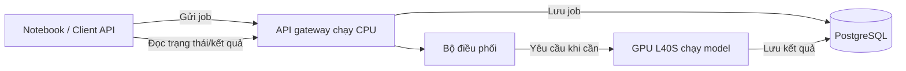

# Multilingual Translation AI Inference

> 🌐 Language / Ngôn ngữ: [English](README.md) | **Tiếng Việt**

[](https://github.com/dangkhoa2016/Multilingual-Translation-AI-Inference/actions/workflows/python-validation.yml)
[](LICENSE)
[](MODEL_LICENSE.vi.md)
[](https://www.python.org/)
[](CHANGELOG.vi.md)

**Bộ công cụ mã nguồn mở để xây dựng API dịch thuật đa ngôn ngữ của bạn.**
Sử dụng bốn model qua cùng một API có xác thực, chạy trên các worker
NVIDIA L40S độc lập và lưu job cùng kết quả trong PostgreSQL.

Bạn có thể tích hợp dịch thuật vào ứng dụng, tìm hiểu đầu ra của từng model
hoặc điều chỉnh kiến trúc cho dịch vụ inference riêng. Mã nguồn MIT,
notebook API và hướng dẫn tiếng Anh/tiếng Việt được chia sẻ để mọi người
sử dụng, học hỏi và phát triển tiếp. [Mời bạn cùng đóng góp](#đóng-góp).

**Bắt đầu — chọn một cách sử dụng:**

| Mục tiêu | Bắt đầu tại | Bạn cần |
|---|---|---|
| **Chạy thử local:** tìm hiểu luồng API | [Chạy thử offline](#bắt-đầu--không-cần-gpu) | Python; không cần tài khoản, token hay GPU |
| **Đã có gateway riêng:** gửi yêu cầu từ notebook | [Notebook API](#notebook-api) | HTTPS gateway đã triển khai và thông tin xác thực của bạn |
| **Tự triển khai:** chạy toàn bộ hệ thống | [Hướng dẫn triển khai](docs/deployment.vi.md) | Tài khoản Modal và PostgreSQL riêng |

**Trong trang này:** [Bắt đầu](#bắt-đầu--không-cần-gpu) · [Tính năng](#dự-án-cung-cấp-những-gì) ·
[Model](#bốn-model-được-hỗ-trợ) · [Ví dụ API](#ví-dụ-gọi-api) ·
[So sánh model](#so-sánh-kết-quả-dịch-giữa-các-model) · [Tài liệu](#tài-liệu) · [Đóng góp](#đóng-góp).

## Bắt đầu — không cần GPU

Cài **Python 3.12 trở lên**, sau đó clone repository:

```bash
git clone https://github.com/dangkhoa2016/Multilingual-Translation-AI-Inference.git
cd Multilingual-Translation-AI-Inference
git checkout v1.0.0

python -m venv .venv
source .venv/bin/activate
python -m pip install -e '.[demo]'
python scripts/examples/local_demo.py
```

**Windows PowerShell** (sau khi clone và vào thư mục repository):

```powershell
py -3 --version  # Xác nhận Python 3.12 trở lên
py -3 -m venv .venv
.\.venv\Scripts\python.exe -m pip install -e ".[demo]"
.\.venv\Scripts\python.exe scripts/examples/local_demo.py
```

Demo gửi và đọc job bằng SQLite tạm thời cùng token mẫu. Kết quả mong đợi:
`POST 202`, `GET 200`, `status: completed` và `is_mock_result: true`.
Đầu ra bắt đầu bằng `[MOCK ONLY — NOT A TRANSLATION; ...]`: đây là luồng API
với văn bản mock, không gọi mạng, đọc `.env` hay sử dụng GPU.

Tiếp theo, thử [notebook API](notebooks/translation_api_demo.ipynb) hoặc
[triển khai gateway riêng](docs/deployment.vi.md) để dịch bằng model thật.

## Dự án cung cấp những gì?

- **Một API cho bốn model:** chọn một backend hoặc gửi cùng văn bản
  đến nhiều model qua job bất đồng bộ.
- **Kết quả được lưu bền vững:** PostgreSQL giữ job, từng lần chạy model
  và bản dịch để truy xuất có xác thực.
- **Thông số theo từng lần chạy:** GET trả số token, thời gian chờ/inference
  và mẫu CPU/GPU tùy chọn; không công khai raw log hay bí mật.
- **GPU worker chạy theo nhu cầu:** mỗi model có L40S worker, tệp GGUF
  được khóa revision, Modal Volume và cấu hình sinh văn bản riêng.
- **Kiểm soát yêu cầu:** xác thực Bearer, giới hạn request/poll, idempotency,
  trần job/run chưa hoàn tất dùng chung PostgreSQL, ngân sách GPU ước tính
  tùy chọn và đối soát job uncertain. Xem [cấu hình](docs/configuration.vi.md).
- **Ví dụ và hướng dẫn có thể tái sử dụng:** demo offline, notebook
  Jupyter/Colab/Kaggle, test CPU và tài liệu triển khai song ngữ.

## Vòng đời một job dịch thuật

Gửi job, để worker tương ứng xử lý, rồi truy xuất trạng thái và bản dịch.
Gateway chạy trên CPU; GPU worker khởi động theo nhu cầu.



Xem [kiến trúc](docs/architecture.vi.md) để tìm hiểu toàn bộ hệ thống và
[quyết định kỹ thuật](docs/design-decisions.vi.md) để hiểu các đánh đổi.

## Bốn model được hỗ trợ

| API model key | Tên model gốc | GPU | Quantization |
|---|---|---|---|
| `hy_mt2_30b` | Tencent Hy-MT2-30B-A3B | L40S 48 GB | GGUF Q8_0 |
| `index_35b` | IndexTeam Index-Translate-35B-A3B-preview | L40S 48 GB | GGUF Q8_0 |
| `gemma4_31b_it` | Google Gemma 4 31B IT | L40S 48 GB | GGUF Q8_0 |
| `qwen35_35b` | Qwen3.5-35B-A3B | L40S 48 GB | GGUF Q8_0 |

Nhập mã hoặc tên ngôn ngữ như `fr`, `zh-Hant` hay `Vietnamese`.
Mỗi yêu cầu nhận tối đa **1.000 Unicode code points**; khả năng hỗ trợ
và chất lượng dịch tùy cặp ngôn ngữ. Văn bản phải mã hóa được thành UTF-8
và không chứa ký tự NUL. Xem [danh mục model](docs/models.vi.md)
để biết quy tắc đầu vào, revision, checksum và số liệu GPU đã ghi nhận.

### Tự triển khai

Bản dịch thật chạy trên **hạ tầng do bạn quản lý**. Làm theo
[hướng dẫn triển khai](docs/deployment.vi.md) để chuẩn bị Modal, PostgreSQL,
Secrets và bốn Volume model. Các [tệp GGUF đã khóa revision](models/four_l40s_workers_q8_0_manifest.json)
có tổng dung lượng **139,33 GB (129,76 GiB)**, được tải riêng với mã nguồn.

Tác vụ GPU có tính phí và cần chủ động bật. GPU scale-to-zero không loại bỏ
chi phí lưu trữ/dịch vụ của Volume hoặc PostgreSQL. **CPU monitor mặc định
không có lịch tự động**; có thể chủ động bật kiểm tra mỗi giờ khi deploy.
Lịch CPU và truy vấn PostgreSQL vẫn có thể tính phí khi không có yêu cầu dịch.
API mặc định là **single-tenant**,
dùng chung Bearer token; xem [cấu hình quyền truy cập](docs/configuration.vi.md),
[bảo mật gateway](docs/security.vi.md) và [vận hành](docs/operations.vi.md)
trước khi chia sẻ deployment.

## Ví dụ gọi API

Sau khi triển khai và bật dispatcher `modal-gpu`, đặt URL gateway và nạp
`TRANSLATION_API_BEARER_TOKEN` từ nơi lưu thông tin xác thực riêng của bạn:

```bash
export TRANSLATION_GATEWAY_BASE_URL="https://YOUR_DEPLOYED_GATEWAY.modal.run"

curl -fsS -X POST "$TRANSLATION_GATEWAY_BASE_URL/v1/jobs/translations" \
  -H "Authorization: Bearer $TRANSLATION_API_BEARER_TOKEN" \
  -H "Idempotency-Key: example-translation-001" \
  -H "Content-Type: application/json" \
  -d '{
    "model": "hy_mt2_30b",
    "source_language": "en",
    "target_language": "vi",
    "text": "The little fox crossed the bridge at sunrise.",
    "options": {"preserve_formatting": true}
  }'
```

HTTP 202 trả về `job_id` và `status_url`. Điền UUID được trả về vào
`JOB_ID`, rồi gọi GET để đọc job bằng cùng Bearer token:

```bash
JOB_ID="YOUR_RETURNED_JOB_UUID"
curl -fsS "$TRANSLATION_GATEWAY_BASE_URL/v1/jobs/$JOB_ID" \
  -H "Authorization: Bearer $TRANSLATION_API_BEARER_TOKEN"
```

Xem attempt mới nhất của từng model trong `runs[]`; tiếp tục polling khi
còn attempt `queued`, `dispatching` hoặc `running`. Mỗi yêu cầu mới dùng
một `Idempotency-Key` mới. Dùng lại key còn lưu với đầu vào khác sẽ trả
**HTTP 409**. Nếu POST có kết quả chưa rõ (uncertain), giữ key/payload gốc
và đối soát với người vận hành trước khi gửi lại.

[Tài liệu API](docs/development.vi.md#jobsubmitted-và-jobview--response-và-quy-tắc-polling)
giải thích ví dụ response, trạng thái job và yêu cầu nhiều model.
[Hướng dẫn vận hành](docs/operations.vi.md#lưu-giữ-job-và-thời-hạn-bảo-vệ-idempotency)
trình bày cách lưu giữ job và thời hạn bảo vệ idempotency.

## So sánh kết quả dịch giữa các model

Để so sánh cùng một văn bản qua nhiều backend, dùng endpoint benchmark với
**idempotency key riêng**, khác với ví dụ dịch một model. Ví dụ chạy thật đầu tiên chọn **hai model** để giảm số lượt
inference cần thực hiện. Bạn có thể chọn 1–4 model key hợp lệ, không trùng nhau; mỗi backend được
chọn đều có thể phát sinh chi phí GPU.

```bash
curl -fsS -X POST "$TRANSLATION_GATEWAY_BASE_URL/v1/jobs/benchmarks" \
  -H "Authorization: Bearer $TRANSLATION_API_BEARER_TOKEN" \
  -H "Idempotency-Key: example-benchmark-001" \
  -H "Content-Type: application/json" \
  -d '{
    "models": ["hy_mt2_30b", "index_35b"],
    "source_language": "en",
    "target_language": "vi",
    "text": "The little fox crossed the bridge at sunrise.",
    "options": {"preserve_formatting": true}
  }'
```

Endpoint benchmark cũng trả HTTP 202 cùng `job_id` và `status_url`. Dùng GET có xác thực ở trên để
kiểm tra attempt mới nhất của từng model trong `runs[]`. **Hệ thống không tự xếp hạng chất lượng bản dịch.**

**Ví dụ synthetic do người viết tự tạo — không phải đầu ra model, kết quả GPU hay điểm chất lượng:**

| Trường | Hy-MT2 (minh họa) | Index (minh họa) |
|---|---|---|
| Trạng thái mới nhất | `completed` | `completed` |
| Ví dụ bản dịch tiếng Việt | Chú cáo nhỏ băng qua cầu lúc bình minh. | Khi mặt trời mọc, chú cáo bé đi qua cây cầu. |

Yêu cầu API minh họa chỉ chọn hai model, nên GET sẽ chứa các run tương ứng. Muốn so sánh cả bốn, bổ
sung `gemma4_31b_it` và `qwen35_35b` vào `models`; thêm model có thể làm tăng chi phí GPU. Hai câu
trên chỉ dùng để minh họa cách trình bày kết quả.

[Notebook](notebooks/translation_api_demo.ipynb) hiển thị trạng thái job, lỗi và bản dịch tùy chọn
theo từng model. Với dữ liệu nhạy cảm hoặc notebook chia sẻ công khai, giữ
`SHOW_TRANSLATIONS=False`.


## Notebook API

**An toàn thực thi:** `Run All` chỉ hoàn toàn ngoại tuyến khi **mọi cờ HTTP live**
đều là `False`, gồm các cờ GET tùy chọn và cả hai cờ POST có phí.
Các cờ GET có thể kết nối tới gateway mà không gửi job dịch mới;
một trong hai cờ POST có phí có thể tạo tác vụ GPU phát sinh chi phí.
Khi dùng inference thật, chỉ chạy đúng các cell theo thứ tự hướng dẫn;
không dùng `Run All` khi đang bật cờ POST có phí.
Nếu POST chưa rõ kết quả, giữ nguyên idempotency key và UUID của job.

**Bản phát hành `1.0.0`:** [Mã nguồn `main`](https://github.com/dangkhoa2016/Multilingual-Translation-AI-Inference/tree/main)
đã nghiệm thu và [tag `v1.0.0`](https://github.com/dangkhoa2016/Multilingual-Translation-AI-Inference/tree/v1.0.0)
cùng xác định một bản chụp mã nguồn hoàn chỉnh tại thời điểm phát hành.
[GitHub Release](https://github.com/dangkhoa2016/Multilingual-Translation-AI-Inference/releases/tag/v1.0.0)
cung cấp bản tải về từ tag tương ứng. Để tái lập đúng phiên bản, ưu tiên
dùng tag vì `main` có thể tiếp tục thay đổi sau khi công khai.

[](https://colab.research.google.com/github/dangkhoa2016/Multilingual-Translation-AI-Inference/blob/v1.0.0/notebooks/translation_api_demo.ipynb)
[](https://www.kaggle.com/notebooks/welcome?src=https://github.com/dangkhoa2016/Multilingual-Translation-AI-Inference/blob/v1.0.0/notebooks/translation_api_demo.ipynb)

Dùng [translation_api_demo.ipynb](notebooks/translation_api_demo.ipynb) trên
Jupyter, Google Colab hoặc Kaggle Notebooks để chọn model, gửi văn bản
và xem bản dịch. Trong **Basic settings**, chọn `DISPLAY_LANGUAGE="vi"` để
xem thông báo bằng tiếng Việt; lựa chọn này độc lập với ngôn ngữ cần dịch.
Với Jupyter local:

```bash
python -m pip install jupyterlab
python -m jupyter lab notebooks/translation_api_demo.ipynb
```

1. Giữ mọi cờ live là `False`, chạy **Run All** một lần để xem bảng mẫu bốn model giả lập (so sánh có phí mặc định hai model).
2. Trong **Basic Settings**, chọn model, ngôn ngữ và văn bản mẫu. Nạp
   gateway và Bearer token qua Secrets riêng.
3. Để dịch có phí, bật `ACKNOWLEDGE_PAID_GPU` và `RUN_SUBMITTED_JOB_POLL`.
   Với một model, bật `RUN_SINGLE_MODEL_POST`, chọn `"single"` cho
   `SUBMITTED_JOB_TO_POLL`. Để so sánh, bật `RUN_MULTI_MODEL_POST`, chọn
   `"multi"` và chọn `MULTI_MODEL_KEYS` (mặc định hai model; chủ động chọn thêm, tối đa bốn). Giữ cờ POST còn lại tắt.
4. Chạy **Basic Settings → Load private Secrets → POST translation → GET job**
   cho một model, hoặc thay **POST translation** bằng **POST benchmark** để so sánh.
   Cả hai chế độ nằm trong Basic Settings; Advanced Settings là tùy chọn.
   **Không Run All khi các cờ POST có phí đang bật.**
5. Để xem bản dịch không nhạy cảm, tắt cả hai POST, bật `SHOW_TRANSLATIONS=True`
   rồi chạy **Basic Settings → GET job**. Bảng đặt kết quả mới nhất của từng model
   vào một cột, kèm trạng thái, mã lỗi và metrics tùy chọn
   (đặt `SHOW_METRICS=False` để ẩn). Metrics thiếu hiển thị `N/A`; mẫu GPU
   không phải mức đỉnh hay trung bình. Nội dung dịch và UUID mặc định được ẩn;
   `SHOW_JOB_IDS=True` cho phép xem UUID trong phiên riêng tư.

Với gateway thật trên Jupyter local, [launcher nhập token ẩn](scripts/examples/launch_jupyter_private.py)
hỏi URL gateway và ẩn ký tự khi nhập token:

```bash
python scripts/examples/launch_jupyter_private.py
```

Các cell code hỗ trợ được thu gọn mặc định để tập trung vào thao tác chính;
có thể mở rộng để kiểm tra mã nguồn client.

Xem **Advanced usage and recovery** trong notebook khi restart kernel,
đọc job đã lưu hoặc xử lý yêu cầu chưa rõ kết quả. Khởi tạo offline lại sau
mỗi lần restart. Trên Windows, dùng `.\.venv\Scripts\python.exe` thay cho `python`.

## Tài liệu

| Tôi muốn… | English | Tiếng Việt |
|---|---|---|
| Tìm hiểu kiến trúc | [Architecture](docs/architecture.md) | [Kiến trúc](docs/architecture.vi.md) |
| Triển khai dịch vụ riêng | [Deployment](docs/deployment.md) | [Triển khai](docs/deployment.vi.md) |
| Cấu hình quyền truy cập và Secrets | [Configuration](docs/configuration.md) | [Cấu hình](docs/configuration.vi.md) |
| Bảo vệ gateway API | [Security](docs/security.md) | [Bảo mật](docs/security.vi.md) |
| Chọn model | [Models](docs/models.md) | [Model](docs/models.vi.md) |
| Tích hợp API hoặc phát triển local | [API and development](docs/development.md) | [API và phát triển](docs/development.vi.md) |
| Theo dõi job và quản lý chi phí | [Operations](docs/operations.md) | [Vận hành](docs/operations.vi.md) |
| Kiểm tra hành vi và kết quả đã ghi nhận | [Reliability](docs/reliability.md) | [Độ tin cậy](docs/reliability.vi.md) |
| Kiểm tra bản cài đặt | [Validation guide](docs/independent-validation.md) | [Kiểm tra cài đặt](docs/independent-validation.vi.md) |
| Hiểu các đánh đổi thiết kế | [Decisions](docs/design-decisions.md) | [Quyết định](docs/design-decisions.vi.md) |
| Tìm hướng đóng góp tiếp theo | [Roadmap](docs/roadmap.md) | [Lộ trình](docs/roadmap.vi.md) |

[Hướng dẫn độ tin cậy](docs/reliability.vi.md#nguồn-gốc-và-giới-hạn-bằng-chứng)
giải thích phạm vi và cách tái lập các bản tổng hợp tích hợp lịch sử trong
[`reports/`](reports). Các báo cáo ghi nhận hành vi hạ tầng; chúng không
chấm điểm chất lượng dịch hay xác nhận dịch vụ đang hoạt động.

## Đóng góp

Mời bạn báo lỗi, chia sẻ ví dụ, cải thiện tài liệu hoặc bổ sung bản dịch.
Bạn có thể đóng góp mà không cần GPU hay tài khoản cloud. Mở
[GitHub Issue](https://github.com/dangkhoa2016/Multilingual-Translation-AI-Inference/issues)
để báo vấn đề hoặc trao đổi ý tưởng, rồi làm theo
[hướng dẫn đóng góp](.github/CONTRIBUTING.vi.md) để gửi pull request.

### Kiểm tra dành cho người đóng góp (tùy chọn)

```bash
python -m pip install -e '.[dev]'
python -m pytest -q
python -m ruff check .
```

Các lệnh này chạy trên CPU. Xem [phát triển](docs/development.vi.md) để biết
các bộ phụ thuộc và [hỗ trợ](.github/SUPPORT.vi.md) khi có câu hỏi sử dụng.
Báo lỗ hổng theo [chính sách bảo mật](.github/SECURITY.vi.md).
Thay đổi mã nguồn và trạng thái phát hành được ghi trong [changelog](CHANGELOG.vi.md).

## Bản quyền và ghi công

Mã nguồn: **MIT © 2026 Đăng Khoa <i.am@dangkhoa.dev>** — xem [LICENSE](LICENSE).
Các model huấn luyện sẵn và bản GGUF giữ giấy phép **Apache-2.0** cùng
ghi công của upstream; trọng số model được phân phối riêng.
Xem [giấy phép model](MODEL_LICENSE.vi.md) và [thông báo bên thứ ba](NOTICE.vi.md).

Đây là dự án cộng đồng độc lập, không trực thuộc Tencent, IndexTeam,
Google, Unsloth, Qwen hay Modal.
